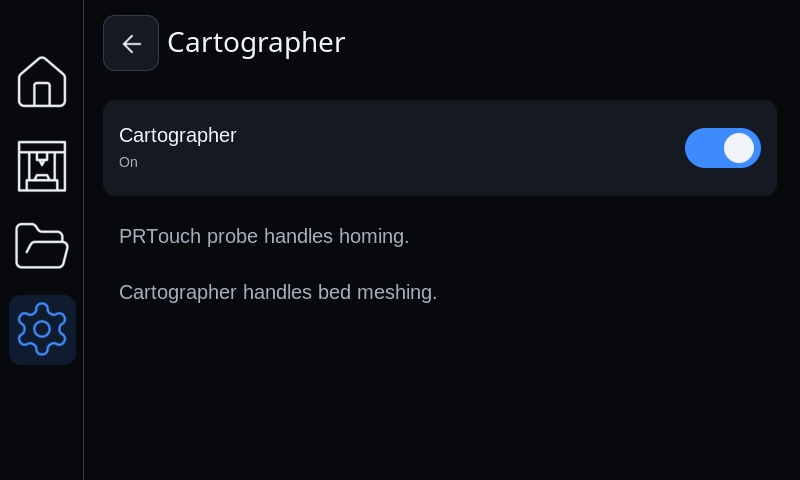
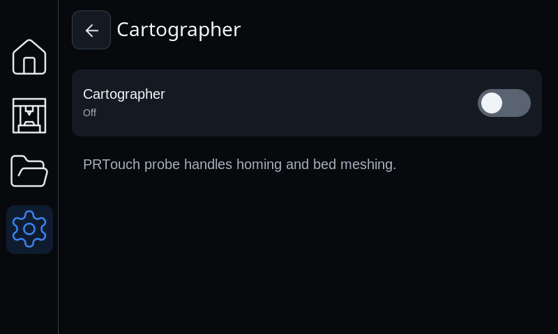
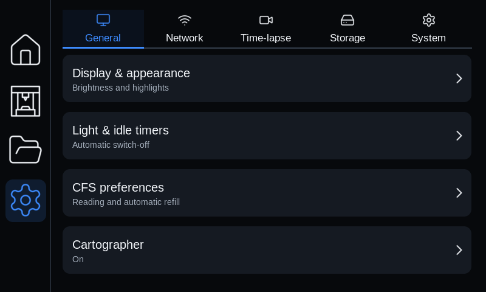
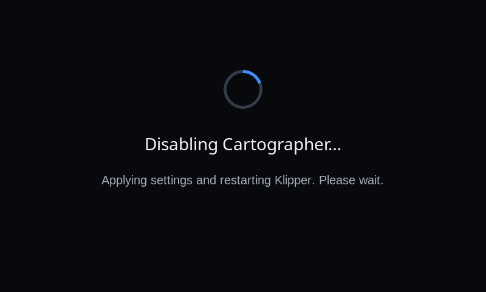

# Cartographer setting

Settings shows a **Cartographer** entry only when the standalone
[k2-openklipper-cartographer add-on](https://github.com/carmanspb/k2-openklipper-cartographer)
is installed and its managed installation is complete. The screen does not install
Cartographer or select a plugin fork/version. The add-on owns those dependencies.

The toggle asks for confirmation, then runs the installed `scripts/k2ctl.py enable`
or `disable` with `--apply`. That utility preserves calibration, manages its USB
service and configuration include, and restarts Klipper. The screen does not edit
printer configuration or issue another restart.

- **On:** PRTouch homing and Cartographer bed scanning.
- **Off:** PRTouch homing and PRTouch bed meshing; installation and saved
  Cartographer calibration remain available.

The toggle is disabled during printing, native motor initialization, movement,
filament changes or another screen operation. Execution checks fresh printer
state again before invoking the add-on. The current lifecycle utility requires
Klipper to be ready; this feature does not bypass shutdown or disconnected status.

A dedicated **Enabling/Disabling Cartographer…** screen stays visible during the
intentional Klipper disconnect. Success requires the utility to complete, the
managed include to match, Klipper to return with the requested configuration and
native motor initialization to finish. The same settings page then shows On/Off.
Failures retain the observed configuration and show an error. If printer state
changes before the backend accepts a request, its rejection immediately returns
the screen to the setting with the reason; no restart is started. Unrelated printer
or local-screen-service disconnections keep their normal recovery behavior.

## Detection and performance

Detection runs once when the backend starts. There are no periodic checks,
page-entry reads, subprocess status polls or additional telemetry subscriptions.
Enable/disable requests recheck the installation and verify their result.
Installing/removing the add-on externally requires restarting the screen backend
to refresh its initial detection.

Detection uses the add-on's existing lifecycle and installation records, managed
include markers, loader ownership and expected control files. There is no
hardcoded plugin version, fork allowlist or controller-release checksum list.
The loader checksum is compared with its own installation record to establish
ownership, not with a touchscreen release pin. These records identify a managed
installation; they are not cryptographic proof of download origin.

## Development and tests

The implementation and its tests live here. Small shared hooks integrate action
policy, settings navigation, snapshot publication, the intentional restart screen
and installation/build packaging.

`tests/test_cartographer_toggle.py` includes these tests in normal discovery:

```sh
python3 -m unittest discover -s tests -v
```

Build the host renderer first to run native UI tests rather than skip them.
Tests cover detection, add-on updates, startup-only reads, confirmation, busy and
printing guards, command delegation, failed verification, expected disconnects,
returning to the setting and unrelated connection loss. Tests use fixtures and
mocks; they do not operate a printer.

## Screenshots

| Enabled integration | Disabled integration |
| --- | --- |
|  |  |




